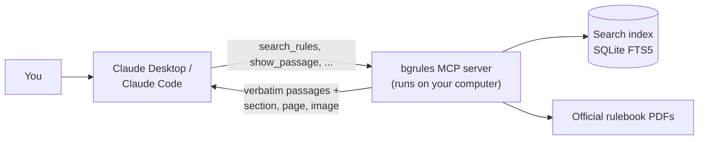

# boardgame-rules-mcp

[](https://github.com/sbcooney/boardgame-rules-mcp/actions/workflows/tests.yml)

An MCP server that answers board game rules questions from the **official rulebook**, citing the exact section and page for every answer.

Ask a rules question in Claude Desktop or Claude Code. The answer quotes the rulebook word for word and says where the text is. It can also show the page with the passage highlighted or open the PDF at that page. If the rulebook doesn't cover the question, the answer says so instead of guessing.

## Example

A real answer, shortened:

> **How much Blight goes on the Healthy Island card in a 2-player game of Spirit Island?**
>
> **Under the current rules, 5.** Older rulebooks say 4, because an official change added 1.
>
> **The printed core rulebook** (before the 14th printing), *Game Setup > Invader Board, p. 6*, says to "Place the shown amount of Blight onto the card": 2 per player, so **4**.
>
> **The official change**, *Nature Incarnate Rulebook, Significant Changes > Blight Errata, p. 5*: "If you are using a Healthy Island card, treat it as if it said "2 per player, +1"." That makes **5**. The core rulebook includes it from the 14th printing onward.

Both quotes are verbatim. Asked the same question without the server, Claude said "5" and didn't mention that the player's own rulebook may say 4.

## How it works



- **Official sources only.** `bgrules add <game>` downloads the publisher's PDF and checks its checksum, or indexes a copy you downloaded yourself. Official errata are indexed as separate documents and linked to the rules they change. Fan FAQs and wikis are never used.
- **The server never writes answers.** It returns rulebook text and its location. The model writes the answer from that text, following the server's instructions: quote, cite, and say when the rulebook doesn't cover something.
- **Layout-aware extraction.** Two-column pages, magazine-style text boxes and tables are read in reading order. Headings become section paths ("Almanac > Robber"). A few dense pages still come out partly jumbled (see [Limitations](#limitations)).
- **Local.** PDFs and the index live in `~/.bgrules`. The repo holds links and checksums, not rulebooks.

## Quick start

Requires [uv](https://docs.astral.sh/uv/) (it installs Python 3.11+ if needed).

```sh
git clone https://github.com/sbcooney/boardgame-rules-mcp && cd boardgame-rules-mcp
uv sync
uv run bgrules add catan --edition 2020
uv run bgrules search catan "What happens when I move the robber?"
```

The server runs locally over stdio, so it works with MCP clients that launch local servers, such as Claude Desktop and Claude Code.

### Connect to Claude Code

```sh
claude mcp add bgrules -- uv --directory /path/to/boardgame-rules-mcp run bgrules serve
```

### Connect to Claude Desktop

Add this to `~/Library/Application Support/Claude/claude_desktop_config.json`, then restart Claude Desktop:

```json
{
  "mcpServers": {
    "bgrules": {
      "command": "uv",
      "args": ["--directory", "/path/to/boardgame-rules-mcp", "run", "bgrules", "serve"]
    }
  }
}
```

If Claude Desktop can't find `uv`, use its full path (`which uv`).

## Tools

| Tool | Returns |
| --- | --- |
| `list_games()` | Installed games, editions and documents, plus each game's official changes (errata) |
| `search_rules(game, query, edition?, max_results?)` | Verbatim passages with citations, or `found: false` with the nearest sections |
| `get_section(section_id)` | A whole section, plus the ids of the sections before and after it |
| `lookup_term(game, term, edition?)` | A section by its exact title, such as an almanac entry |
| `show_passage(citation_id)` | An image of the page region with the cited passage highlighted |
| `get_page(game, page, edition?, document?)` | A whole page image with its rules text highlighted, plus the passages on it |
| `open_in_rulebook(citation_id)` | Opens the PDF on your computer at the cited page (in Chrome, Firefox, Edge or Brave; other PDF viewers open at page 1) |
| `verify_quote(citation_id, text)` | Whether a quote appears word for word in the cited section |

Prompts: `setup-game(game, players)` walks through setup and raises official changes first; `ask-rules(game, question)` answers one question strictly from the rulebook.

## Supported games

| Game | Rulebook | Install |
| --- | --- | --- |
| Catan (2020 edition) | Official PDF, downloaded automatically | `uv run bgrules add catan --edition 2020` |
| Wingspan (base game) | Rulebook r24 and appendix r17 from [Stonemaier's official folder](https://www.dropbox.com/scl/fo/cfbnrvnwwms1fz7589byc/AI8I9LEYzDESkEkm_s3FhSo?rlkey=cykjw2zk47cehkebrl3a5wl7b&dl=0). The folder has no direct per-file links, so you download the two PDFs yourself. | `uv run bgrules add wingspan --doc rulebook --file WS_Rulebook_r24.pdf`, then `--doc appendix --file WS_Appendix_r17.pdf` |
| Spirit Island (core game) | Core rulebook plus the official errata pages of the Nature Incarnate rulebook, downloaded automatically from Greater Than Games' links | `uv run bgrules add spirit-island` |
| Brass: Birmingham | Rulebook v2018.11 from [Roxley's product page](https://roxley.com/products/brass-birmingham), downloaded automatically | `uv run bgrules add brass-birmingham` |
| Disney Villainous (2018 base game, plus Villain Guides) | Instructions from Ravensburger's site, downloaded automatically. Each Villain's objective and cards are in its Villain Guide: Ravensburger's own PDFs, available only as [BoardGameGeek uploads](https://boardgamegeek.com/boardgame/256382/disney-villainous-the-worst-takes-it-all/files), so you download those yourself. Guides set up so far: the six base Villains, *Wicked to the Core*'s three, *Perfectly Wretched*'s three (those exist only as image copies, so their text is read by OCR and labelled that way), *Evil Comes Prepared*'s Ratigan, Scar and Yzma, and *Despicable Plots*' Gaston, Lady Tremaine and Horned King, plus both sets' Instructions, which add the rules for mixing boxes. | `uv run bgrules add villainous` installs the Instructions and lists each guide with its download page |
| Star Wars Villainous: Power of the Dark Side | Instructions from Ravensburger's site, downloaded automatically. Shared rules only, as with Disney Villainous. | `uv run bgrules add star-wars-villainous` |
| Tzolk'in: The Mayan Calendar | Rulebook from [Czech Games Edition](https://www.czechgames.com/games/tzolkin-the-mayan-calendar), downloaded automatically | `uv run bgrules add tzolkin` |
| A Feast for Odin | 2nd edition rulebook and appendix (every occupation card) from [Feuerland](https://www.feuerland-spiele.de/en), downloaded automatically. The almanac is Viking history, not rules, so it isn't indexed. | `uv run bgrules add a-feast-for-odin` |
| Sushi Roll | Rules of Play from [Gamewright](https://gamewright.com/product/Sushi-Roll), downloaded automatically. It's a fold-out sheet with no page numbers, so citations use the PDF's panels. | `uv run bgrules add sushi-roll` |

## Adding a game

Each game is an entry in [`src/bgrules/manifest.yaml`](src/bgrules/manifest.yaml).

1. **Find the official PDF** on the publisher's site. Only publisher-issued rulebooks and errata qualify. For a direct download link, add `url` and `sha256`. Otherwise, set `source: user_supplied`, `expected_sha256` and a `download_page` saying where users get the file, and install the PDF with `--file`. A publisher's own document that is only available on a community site (such as a Villain Guide on BoardGameGeek) can be added this way, labelled in its title; fan-written FAQs and wikis can't. Pages without a text layer are read by OCR automatically; `ocr` hints tune it for awkward layouts (see the Perfectly Wretched guides in the manifest).
2. **Add extraction hints.** `uv run python spikes/m0_extract.py <pdf>` lists the fonts and sizes on each page. Use them to set `layout` (`columns`, `rows`, `boxes` or `table`), `heading_fonts`, `body_fonts`, `body_size` and `content_pages`. The three existing games cover the common layouts.
3. **Index and check.** Run `uv run bgrules add <game>`, then `uv run bgrules search <game> "..."`. Check the section paths and quotes; garbled or interleaved text means a hint needs adjusting.
4. **Write eval questions** in `evals/<game>_<edition>.yaml` and run `uv run python evals/retrieval.py evals/<game>_<edition>.yaml`. This is free: it makes no model calls.
5. **Add official changes**, if any, as their own document with `source_type: errata`, and use `amends` to link each change to the section it changes.

## Results

Two evals: **end-to-end** checks the answers Claude writes with and without the server, and **retrieval** checks whether search finds the right section. The question sets are small and were mostly written by the developer, so read the numbers as indicative.

### End-to-end (with vs. without the server)

Each question is asked twice through Claude Code's headless mode: once with no tools (answering from memory) and once with only this server. A grader model (Claude Haiku) scores each answer against the expected ruling. Every quote in an answer is checked against the rulebook text locally.

Core question sets: Catan 15 questions, Wingspan 13, Spirit Island 16.

| Metric | Catan, memory | Catan, server | Wingspan, memory | Wingspan, server | Spirit Island, memory | Spirit Island, server |
| --- | --- | --- | --- | --- | --- | --- |
| Correct rulings (answerable questions) | 96% | 100% | 91% | 100% | 82% | 100% |
| Said "not covered" when the rulebook doesn't cover it | 100% | 100% | 50% | 100% | 0% | 100% |
| Wrongly said "not covered" | 0% | 0% | 0% | 0% | 0% | 0% |
| Cited a correct section | 77% | 92% | 18% | 100% | 21% | 93% |
| Quotes not found in the rulebook | 2 of 9 | 0 of 48 | 8 of 8 | 0 of 42 | 1 of 3 | 0 of 72 |

- **Quotes:** every quote in the server answers appears verbatim in the rulebooks. From memory, Claude quoted less often, and about half of those quotes (10 of 20) were paraphrases presented as exact text.
- **Errata:** on both Spirit Island errata questions, the server answers give the printed rule, the official change, and which printings include it. Answers from memory give only the current rule.
- **Catan:** Claude already knows Catan well, so answers from memory were nearly as accurate; the server adds citations and checkable quotes.
- **A rulebook's silence is not a ruling.** In the first run, some answers correctly found no rule on a question (trading cards, take-backs), then added "so you can't". The server instructions now forbid that. In a rerun of those six questions plus one other, all seven scored full marks. The table combines both runs: those seven server answers are from the rerun, the rest from the first run.

The harness runs on a Claude subscription through `claude -p`, so it needs no API key. It caches answers, so a rerun only redoes what changed.

```sh
uv run python evals/e2e.py --dry-run                                  # show the commands, call nothing
uv run python evals/e2e.py --limit 1                                  # one question
uv run python evals/e2e.py evals/spirit_island_1st.yaml               # a game's core set; --all for every question
uv run python evals/e2e.py evals/catan_2020.yaml --ids vocab-church   # specific questions
```

### Retrieval (search only, no model)

A hit means a section that settles the question, or a subsection of it, is in the top results. Categories: **lookup** asks directly, **edge** covers rules arguments, **vocab** uses players' words instead of the rulebook's ("thief" for robber), **independent** questions were written by a player who hadn't seen the synonym lists, and **not addressed** questions aren't answered by the rulebook.

#### Catan (2020 edition), [`evals/catan_2020.yaml`](evals/catan_2020.yaml)

| Category | n | Hit@1 | Hit@3 | Hit@5 | Hit@5 before synonyms | Correctly said "not found" |
| --- | --- | --- | --- | --- | --- | --- |
| lookup | 15 | 53% | 73% | 73% | 73% | – |
| edge | 22 | 73% | 95% | 95% | 95% | – |
| vocab | 5 | 40% | 60% | 80% | 60% | – |
| vocab, held out | 10 | 60% | 90% | 100% | 30% | – |
| independent | 5 | 60% | 80% | 80% | – | – |
| not addressed | 5 | – | – | – | – | 40% |
| **all answerable** | 57 | 61% | 84% | 88% | – | – |

Synonyms map players' words to rulebook terms ("thief" → robber, "port" → harbor; see `synonyms` in the manifest). The held-out questions were committed before the synonym list but by the same author, so their 100% is optimistic. The independent questions are the fairer test, at 80%. Their one miss, "How many cards do I deal out?", assumes something Catan doesn't do: no cards are dealt.

#### Wingspan (rulebook r24 + appendix r17), [`evals/wingspan_1st.yaml`](evals/wingspan_1st.yaml)

| Category | n | Hit@1 | Hit@3 | Hit@5 | Hit@5 before synonyms | Correctly said "not found" |
| --- | --- | --- | --- | --- | --- | --- |
| lookup | 12 | 33% | 83% | 92% | 92% | – |
| edge | 17 | 71% | 76% | 88% | 82% | – |
| vocab | 5 | 20% | 40% | 80% | 40% | – |
| appendix (specific birds, bonus cards) | 12 | 100% | 100% | 100% | 100% | – |
| independent | 3 | 0% | 67% | 67% | – | – |
| not addressed | 6 | – | – | – | – | 0% |
| **all answerable** | 49 | 59% | 80% | 90% | – | – |

The appendix explains every bird power and bonus card, so questions about a specific card always find it. The cost is that a few rulebook questions rank lower. Wingspan's synonym list leaves out words the rulebook already uses with another meaning ("move" a cube, "score" a goal, player-mat "rows"). Of the three independent questions, two find the answer in the top 5. The miss, "How many cards do I get to start?", loses to the Swift-Start guide.

#### Spirit Island (core rulebook + official errata), [`evals/spirit_island_1st.yaml`](evals/spirit_island_1st.yaml)

| Category | n | Hit@1 | Hit@3 | Hit@5 | Correctly said "not found" |
| --- | --- | --- | --- | --- | --- |
| lookup | 14 | 57% | 86% | 86% | – |
| edge | 20 | 70% | 90% | 90% | – |
| vocab | 5 | 40% | 80% | 80% | – |
| errata (official changes) | 4 | 75% | 75% | 100% | – |
| not addressed | 4 | – | – | – | 50% |
| **all answerable** | 43 | 63% | 86% | 88% | – |

This is the densest rulebook, with about twice Catan's text, and it has no synonym list yet. Some questions that sound unanswerable are answered by sidebars ("Is there a time limit?" by *The Urgency of War*), so the not-addressed questions were chosen with care.

**Official changes.** Spirit Island's setup was officially changed after older printings: the Nature Incarnate rulebook (p. 5) adds 1 Blight at setup and says this applies whether or not you use the expansion. Only those publisher pages are indexed. They're linked to the core rulebook's setup section, so search results from that section carry the change (`amended_by`). The server instructions tell the model to give both the printed rule and the change, with which printings include it.

#### Six more games

Two question sets per game. The first was written from each rulebook's text. The second is **real players' questions from each game's BoardGameGeek Rules forum**, kept close to their own wording ("Can I consume both merchant beer barrels at a location when selling one industry tile that needs 2 beer?"), with expected answers checked against the rulebook, not the forum replies. Forum questions the rulebook doesn't settle (are Ambition tokens limited?) are in the "not covered" set.

| Game | Written from the rulebook: questions, hit@5 | Players' forum questions: questions, hit@1, hit@5 |
| --- | --- | --- |
| Brass: Birmingham ([`evals/brass_birmingham_2018.yaml`](evals/brass_birmingham_2018.yaml)) | 15, 87% | 10, 20%, 80% |
| Disney Villainous, with Villain Guides ([`evals/villainous_2018.yaml`](evals/villainous_2018.yaml)) | 28, 71% | 5, 40%, 60% |
| Star Wars Villainous ([`evals/star_wars_villainous_2022.yaml`](evals/star_wars_villainous_2022.yaml)) | 15, 80% | 6, 67%, 83% |
| Tzolk'in ([`evals/tzolkin_1st.yaml`](evals/tzolkin_1st.yaml)) | 16, 81% | 10, 50%, 80% |
| A Feast for Odin ([`evals/a_feast_for_odin_2nd.yaml`](evals/a_feast_for_odin_2nd.yaml)) | 19, 84% | 8, 62%, 75% |
| Sushi Roll ([`evals/sushi_roll_1st.yaml`](evals/sushi_roll_1st.yaml)) | 18, 94% | 10, 70%, 90% |

Across all six, 39 of 49 players' questions (80%) find the settling section in the top 5, but only 51% rank it first: real questions are wordier than ones written from the rulebook. Most misses are vocabulary (players say "feed your people" and "win"; the rulebooks say "Banquet Table" and "Objective"), and none of these games has a synonym list yet. In Villainous, three overlapping rulebooks (the base game and two expansions reword the same rules) and the Villain Guides compete for the top results. The forum questions also caught a search bug: "the 10th spot" didn't match "action space (10)"; ordinals now match their number.

**Answers to the players' questions (end-to-end).** Asked through Claude with only this server, the 49 answerable forum questions scored **86%** on ruling accuracy (42 of 49 points, partial answers counting half), above search's 80% top-5 hit rate: when the first search misses, Claude searches again with the rulebook's words. All 3 questions the rulebook doesn't settle were answered "not covered". The main weakness was the opposite of guessing: in 5 of 49 answers Claude said the rulebook doesn't settle a question that a general rule does ("any 1 die on another player's conveyor belt" covers swapping back a die just taken). A new server instruction (a general rule settles the cases it covers; say "not covered" only when no rule does) fixed 2 of the 5 on a rerun, lifting the total to **89%**, and the 3 unsettled questions stayed "not covered". By game, before that fix: Sushi Roll 85%, Brass: Birmingham 75%, Tzolk'in 95%, Feast for Odin 94%, Disney Villainous 90%, Star Wars Villainous 75%. No quote was invented: the one of 222 that failed the verbatim check is real rulebook text that extraction had scrambled (below).

**Synonyms, tested honestly.** Writing synonyms from these same questions would only inflate the score, so they came from a separate development batch: 50 older Rules-forum threads per game (11 for Star Wars Villainous; Sushi Roll has only the 17 already used). Words players used there that the rulebook never does became synonyms: Brass "city" → location, "train" → rail, "boat" → canal; Tzolk'in "wheel" → gear, "spin" → advance; Feast for Odin "cow" → cattle, "flip" → turn, "upgrade" → exchange. The Villainous threads were about specific cards, not general vocabulary. **Effect on the test questions: none.** The misses are about meaning, not a fixed set of words ("feed your people" should find the Banquet Table; "win" should find each Villain's Objective), so a word list built without seeing them doesn't reach them. That points to semantic search, or to the model retrying with the rulebook's terms, rather than longer synonym lists.

Each needed a little layout work, all as opt-in extraction hints so the earlier games extract exactly as before. Brass prints two pages per PDF page, so citations give the printed page of the half the text is on. Tzolk'in and Brass draw their page titles as graphics. Villainous starts sentences with headings ("**Ally** cards appear only in the Villain deck"). Feast for Odin's card index becomes one citable entry per card.

Keyword search can't reliably tell that a rulebook *doesn't* cover something, which is why "not found" scores are low here. That judgment is left to the model, and the end-to-end eval measures it.

```sh
uv run python evals/retrieval.py evals/wingspan_1st.yaml --misses   # Catan by default
```

## Limitations

- **Keyword search, not semantic search.** Questions worded very differently from the rulebook can miss; per-game synonym lists cover common table talk.
- **Scans and image-only PDFs are read by OCR.** A page with no text layer (a scan, a photo, a "print to PDF" copy) is read with macOS's built-in text recognition, and the document's citations say "text read by OCR". OCR can misread a character (an apostrophe dropped, for instance), so quotes from those documents are less certain. It needs macOS for now.
- **Icons aren't text.** Rules printed as icons (food types, dice faces, nest symbols) are only partly captured.
- **A few jumbled pages.** Some dense table pages in the Wingspan appendix (for example p. 12) extract partly interleaved. Answers can still quote them correctly, but the local quote check can fail on them.
- **A scrambled setup step.** On Brass: Birmingham's setup page, callout letters in another font break the word order of some steps ("Separate the Wild Location Wild Industry them face up…"). A correct quote of the printed rule then fails the verbatim check.
- **Sidebars can land mid-section.** On busy layouts (Feast for Odin, Brass), an example box or caption is sometimes placed between two paragraphs of the section beside it. Sentences stay intact, so quotes are still verbatim.
- **Only what's indexed.** Expansions, scenarios and card text outside the rulebooks aren't covered; for Villainous that means each Villain's own cards.
- **Answers depend on the model following the server's instructions.** The server supplies text and citations; it can't stop a client from ignoring them.

## License

MIT
