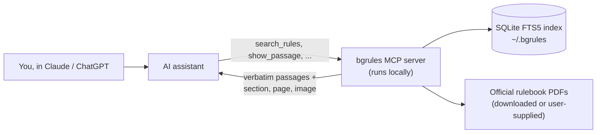

# boardgame-rules-mcp

[](https://github.com/sbcooney/boardgame-rules-mcp/actions/workflows/tests.yml)

An MCP server that answers board game rules questions from the **official rulebook**, and points you to the exact section and page every answer comes from.

Ask a rules question in Claude (or any MCP client) and get the rulebook's own words back, with section, page and a highlighted image of the page. If the rulebook doesn't cover it, the answer says so instead of guessing.

## Example

> **How much Blight goes on the Healthy Island card in a 2-player game of Spirit Island?**
>
> **Under the current rules, 5 Blight go on the card in a 2-player game.** Older rulebooks give 4, because an official change added 1.
>
> **What the printed core rulebook says** (before the 14th printing): *Game Setup > Invader Board, p. 6* says to place "the shown amount of Blight onto the card": 2 per player, so **4**.
>
> **The official change** (*Nature Incarnate Rulebook, Significant Changes > Blight Errata, p. 5*): "If you are using a Healthy Island card, treat it as if it said "2 per player, +1"." That makes **5**. It's printed in the core rulebook from the 14th printing onward.

Every quote above is verbatim, and `show_passage` returns the cited region of the page:


Answering the same question from memory, Claude gave "5" and never mentioned that the player's own rulebook may say 4. Across 44 eval questions, answers using the server had **no invented quotes**, while most quotes given from memory were paraphrases; see [Results](#results).

## How it works



- **Official sources only.** `bgrules add <game>` downloads the publisher's PDF (checksum-verified) or uses one you supply. Official errata are indexed as their own documents and linked to the rules they change. Fan FAQs are never used.
- **The server never writes answers.** It returns exact rulebook text and where it is; the assistant answers only from that.
- **Layout-aware extraction.** Multi-column pages, magazine-style text boxes and tables are read in order, with headings turned into section paths ("Almanac > Robber").
- **Local.** No rulebook content is stored in this repo; the index lives on your machine.

## Quick start

Requires [uv](https://docs.astral.sh/uv/).

```sh
git clone https://github.com/sbcooney/boardgame-rules-mcp && cd boardgame-rules-mcp
uv sync
uv run bgrules add catan --edition 2020
uv run bgrules search catan "What happens when I move the robber?"
```

### Connect to Claude Code

```sh
claude mcp add bgrules -- uv --directory /path/to/boardgame-rules-mcp run bgrules serve
```

### Connect to Claude Desktop

Add to `~/Library/Application Support/Claude/claude_desktop_config.json`, then restart Claude Desktop:

```json
{
  "mcpServers": {
    "bgrules": {
      "command": "uv",
      "args": ["--directory", "/path/to/boardgame-rules-mcp", "run", "bgrules", "serve"]
    }
  }
}
```

If Claude Desktop can't find `uv`, use its full path (`which uv`).

## Tools

| Tool | Returns |
| --- | --- |
| `list_games` | Installed games, editions and documents |
| `search_rules(game, query, edition?)` | Verbatim passages with citations, or `found: false` with the nearest sections |
| `get_section(section_id)` | A full section, plus the sections before and after it |
| `lookup_term(game, term, edition?)` | An almanac/glossary entry by exact title |
| `show_passage(citation_id)` | An image of the rulebook page region with the cited passage highlighted |
| `get_page(game, page, edition?)` | A whole page image with rules text highlighted, plus the passages on it |
| `open_in_rulebook(citation_id)` | Opens the PDF on your computer at the cited page (Chrome/Firefox/Edge/Brave jump to the page; Preview can't) |
| `verify_quote(citation_id, text)` | Confirms a quote appears word for word in the cited section |

## Supported games

| Game | Rulebook source | Status |
| --- | --- | --- |
| Catan (2020 edition) | Official PDF, auto-downloaded | Working |
| Wingspan (base game: rulebook r24 + appendix r17) | User-supplied PDFs from [Stonemaier's official folder](https://www.dropbox.com/scl/fo/cfbnrvnwwms1fz7589byc/AI8I9LEYzDESkEkm_s3FhSo?rlkey=cykjw2zk47cehkebrl3a5wl7b&dl=0): `bgrules add wingspan --doc rulebook --file WS_Rulebook_r24.pdf`, then `--doc appendix --file WS_Appendix_r17.pdf` | Working |
| Spirit Island (core rulebook + official errata) | Official PDFs, auto-downloaded (Greater Than Games' links): `bgrules add spirit-island` | Working |

## Adding a game

Games are entries in [`src/bgrules/manifest.yaml`](src/bgrules/manifest.yaml): links and checksums, never rulebook text.

1. **Find the official PDF** on the publisher's site. Only publisher-issued rulebooks and errata qualify. With a direct link, add `url` and `sha256`; otherwise use `source: user_supplied` and `expected_sha256`, and add it with `--file`.
2. **Add extraction hints.** Run `uv run python spikes/m0_extract.py <pdf>` to see the fonts and sizes on each page, then set `layout` (`columns`, `rows`, `boxes` or `table`), `heading_fonts`, `body_fonts`, `body_size` and `content_pages`. The Catan, Wingspan and Spirit Island entries cover the common layouts.
3. **Index and check:** `uv run bgrules add <game>`, then `uv run bgrules search <game> "..."`. Look at the section paths and quotes; garbled or interleaved text means a hint needs adjusting.
4. **Add eval questions** in `evals/<game>_<edition>.yaml` and run `uv run python evals/retrieval.py evals/<game>_<edition>.yaml` (free; no model calls).
5. **Official changes:** add errata as their own document with `source_type: errata` and `amends:` linking each change to the section it changes.

## Results

### Retrieval (server only, no model)

Question sets cover direct lookups, rules arguments and edge cases, questions worded differently from the rulebook ("thief" for robber), and questions the rulebook doesn't answer. A hit means a section that settles the question (or a subsection of it) is among the top results.

#### Catan (2020 edition): [`evals/catan_2020.yaml`](evals/catan_2020.yaml)

| Category | n | Hit@1 | Hit@3 | Hit@5 | Hit@5 before synonyms | Correctly said "not found" |
| --- | --- | --- | --- | --- | --- | --- |
| lookup | 15 | 53% | 73% | 73% | 73% | – |
| edge | 22 | 73% | 95% | 95% | 95% | – |
| vocab | 5 | 40% | 60% | 80% | 60% | – |
| vocab, held out | 10 | 60% | 90% | 100% | 30% | – |
| independent | 5 | 60% | 80% | 80% | – | – |
| not_addressed | 5 | – | – | – | – | 40% |
| **all answerable** | 57 | 61% | 84% | 88% | – | – |

#### Wingspan (base game, rulebook r24 + appendix r17): [`evals/wingspan_1st.yaml`](evals/wingspan_1st.yaml)

| Category | n | Hit@1 | Hit@3 | Hit@5 | Hit@5 before synonyms | Correctly said "not found" |
| --- | --- | --- | --- | --- | --- | --- |
| lookup | 12 | 33% | 83% | 92% | 92% | – |
| edge | 17 | 71% | 76% | 88% | 82% | – |
| vocab | 5 | 20% | 40% | 80% | 40% | – |
| appendix (specific birds, bonus cards) | 12 | 100% | 100% | 100% | 100% | – |
| independent | 3 | 0% | 67% | 67% | – | – |
| not_addressed | 6 | – | – | – | – | 0% |
| **all answerable** | 49 | 59% | 80% | 90% | – | – |

The appendix explains every bird power and bonus card; questions about a specific bird now find it 100% of the time. It costs a little elsewhere: a few rulebook questions rank lower or drop out of the top 5 ("How many birds per habitat?"), and the larger index gives off-topic questions more partial matches. Its bird-power pages are tables (bird names beside shared power text), read with a table layout that keeps each power sentence intact with its birds listed before it.

Wingspan's synonym list ("dice tower" → birdfeeder, "reroll" → throw, "market" → bird tray) leaves out words the rulebook already uses with a different meaning ("move" a cube, "score" a goal, player-mat "rows"), which had pushed two appendix answers down. Same caveat as Catan: the vocab questions were written by the list's author, so 80% is optimistic; "When am I allowed to reroll the birdfeeder?", an ordinary edge-case question, going from a miss to #2 is the more honest signal. So are the *independent* questions, written by a Wingspan player without seeing the list: 2 of 3 answerable ones land in the top 5 ("How many cards do I get to start?" loses to the Swift-Start guide section), and neither of their two questions the text can't answer (nest odds, dice faces, shown only as pictures) is flagged not-found.

#### Spirit Island (core rulebook): [`evals/spirit_island_1st.yaml`](evals/spirit_island_1st.yaml)

| Category | n | Hit@1 | Hit@3 | Hit@5 | Correctly said "not found" |
| --- | --- | --- | --- | --- | --- |
| lookup | 14 | 57% | 86% | 86% | – |
| edge | 20 | 70% | 90% | 90% | – |
| vocab | 5 | 40% | 80% | 80% | – |
| errata (official changes) | 4 | 75% | 75% | 100% | – |
| not_addressed | 4 | – | – | – | 50% |
| **all answerable** | 43 | 63% | 86% | 88% | – |

The densest of the three rulebooks (32 pages, about twice Catan's text), with no synonym list yet. Several questions that sound unanswerable are covered by sidebars ("Is there a time limit?" by *The Urgency of War*; "Do we rewind a mistake?" by *Whoops!*), so the not-addressed set was chosen with care.

**Official changes (errata).** Spirit Island's setup rules were officially changed after older printings: the Nature Incarnate rulebook (p. 5) adds 1 Blight at setup, and says the change applies whether or not you use the expansion. Only that publisher-issued page is indexed (community FAQs are not used as sources), and it's linked to the core rulebook's setup section: any answer drawing on that section carries the change (`amended_by`), and the server instructs the model to give both the printed rule and the official change, with which printings have which. `list_games` reports each game's official changes so they can be raised when a game is set up.

Synonyms map table talk to rulebook terms ("thief" → robber, "port" → harbor; see `synonyms` in [`manifest.yaml`](src/bgrules/manifest.yaml)). **Caveat:** the held-out questions were committed before the synonym list, but by the same author in the same session, and the list ended up covering most of their wording, so their 100% is optimistic. The *independent* questions are the fairer test: written by a Catan player without seeing the synonym list, they score 80%. The miss ("How many cards do I deal out?") assumes a mechanic Catan doesn't have; no cards are dealt, which keyword search can't bridge.

Run it: `uv run python evals/retrieval.py [evals/<game>.yaml] --misses` (Catan by default)

Keyword overlap can't reliably tell that a rulebook *doesn't* cover something, so that judgment is left to the model reading the returned passages. The end-to-end eval measures it.

### End-to-end (with vs. without the server)

The harness asks each question twice through Claude Code's headless mode: once with no tools (answering from memory), and once with only this server. A grader call scores each answer, and every quote is checked against the rulebook locally. Metrics: ruling accuracy, correct "not covered" answers, cited sections, and quotes that aren't in the rulebook.

It runs on your Claude subscription (no API key or billing), uses a 15-question core subset by default, and caches answers so reruns only redo what changed:

```sh
uv run python evals/e2e.py --dry-run   # show the commands, call nothing
uv run python evals/e2e.py --limit 1   # smoke test
uv run python evals/e2e.py             # core subset; --all for every question
```

Core subsets (Catan 15 questions, Wingspan 13, Spirit Island 16), each answered from memory and with the server:

| Metric | Catan memory | Catan server | Wingspan memory | Wingspan server | Spirit Island memory | Spirit Island server |
| --- | --- | --- | --- | --- | --- | --- |
| Ruling accuracy (answerable) | 96% | 100% | 91% | 100% | 82% | 100% |
| Said "not covered" when the rulebook doesn't cover it | 100% | 100% | 50% | 100% | 0% | 100% |
| Wrongly said "not covered" | 0% | 0% | 0% | 0% | 0% | 0% |
| Cited a correct section | 77% | 92% | 18% | 100% | 21% | 93% |
| Quotes not in the rulebook | 2 of 9 | 0 of 48 | 8 of 8 | 0 of 42 | 1 of 3 | 0 of 72 |

- **No invented quotes with the server:** all 162 quotes in its answers appear verbatim in the rulebooks. From memory, Claude quoted rarely, and most of those quotes were paraphrases presented as exact text.
- **Errata:** on both Spirit Island errata questions, the server answers give the printed rule (4 Blight for 2 players), the official change (5), and which printings carry it. Answers from memory give only the current number.
- **Catan:** Claude already knows Catan well, so from memory it does almost as well; the server adds citations and verifiable quotes. The first run missed "how many cards does a church collect?": the answer said the rulebook has no church, overlooking the components list ("16 cities … shaped like churches") that search had returned.
- **Silence isn't a ruling:** early answers to unanswered questions (trading cards, take-backs) correctly found no rule, then added "so you can't". The server instructions now say a rulebook's silence is not a ruling; on a rerun, all six of those questions, plus the church question, scored full marks. Other cells are from the earlier run.
- **Known checker gap:** text from jumbled appendix pages (Wingspan p. 12) can be quoted correctly but still fail the verbatim check.

## License

MIT
