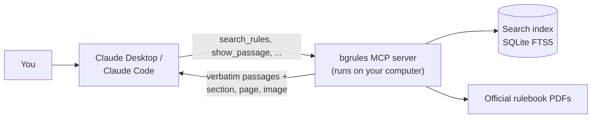

# boardgame-rules-mcp

[](https://github.com/sbcooney/boardgame-rules-mcp/actions/workflows/tests.yml)
[](https://pypi.org/project/boardgame-rules-mcp/)

An MCP server that answers board game rules questions from the **official rulebook**, citing the exact section and page for every answer.

Ask a rules question in Claude Desktop or Claude Code. The answer quotes the rulebook word for word and says where the text is. It also shows the rule as printed, with the quoted words underlined, and can open the PDF at that page. If the rulebook doesn't cover the question, the answer says so instead of guessing.

## Example

A real answer, shortened:

> **How much Blight goes on the Healthy Island card in a 2-player game of Spirit Island?**
>
> **Under the current rules, 5.** Older rulebooks say 4, because an official change added 1.
>
> **The printed core rulebook** (before the 14th printing), *Game Setup > Invader Board, p. 6*, says to "Place the shown amount of Blight onto the card": 2 per player, so **4**.
>
> **The official change**, *Nature Incarnate Rulebook, Significant Changes > Blight Errata, p. 5*: "If you are using a Healthy Island card, treat it as if it said "2 per player, +1"." That makes **5**. The core rulebook includes it from the 14th printing onward.

Both quotes are verbatim. Asked the same question without the server, Claude said "5" and didn't mention that the player's own rulebook may say 4.

## How it works



- **Official sources only.** `bgrules add <game>` downloads the publisher's PDF and checks its checksum, or indexes a copy you downloaded yourself. Official errata are indexed as separate documents and linked to the rules they change. Fan FAQs and wikis are never used.
- **The server never writes answers.** It returns rulebook text and its location. The model writes the answer from that text, following the server's instructions: quote, cite, and say when the rulebook doesn't cover something.
- **Layout-aware extraction.** Two-column pages, magazine-style text boxes and tables are read in reading order. Headings become section paths ("Almanac > Robber"). A few dense pages still come out partly jumbled (see [Limitations](#limitations)).
- **Local.** PDFs and the index live in `~/.bgrules`. The repo holds links and checksums, not rulebooks.

## Install in Claude Desktop

No terminal needed:

1. Download `boardgame-rules-mcp-<version>.mcpb` from the [latest release](https://github.com/sbcooney/boardgame-rules-mcp/releases/latest).
2. Double-click it, and choose **Install** in Claude Desktop. On first start, Claude Desktop sets up Python and the server's dependencies, which takes a minute.
3. Ask Claude to add a game: "Add Catan, 2020 edition." Claude downloads the rulebook from the publisher and indexes it on your computer. Long rulebooks take a minute or two.

For a rulebook that can't be downloaded automatically (Wingspan, the Villainous guides), Claude gives you the publisher's download page; download the PDF and tell Claude where you saved it.

For a game that isn't supported, you can [add your own copy of its rulebook](#your-own-rulebook): "Add my Root rulebook, it's in ~/Downloads/root-rules.pdf," or give Claude a link to the publisher's PDF.

The extension shares `~/.bgrules` with the command line below, so games added either way show up in both.

## Quick start

Requires [uv](https://docs.astral.sh/uv/) (it installs Python 3.11+ if needed).

```sh
uv tool install boardgame-rules-mcp
bgrules add catan --edition 2020
bgrules search catan "What happens when I move the robber?"
```

This puts the `bgrules` command on your PATH; `uv tool upgrade boardgame-rules-mcp` updates it. Rulebooks and the index live in `~/.bgrules` (set `BGRULES_HOME` to move them). To try it without installing, run `uvx boardgame-rules-mcp` in place of `bgrules`.

The server runs locally over stdio, so it works with MCP clients that launch local servers, such as Claude Desktop and Claude Code. The Claude mobile apps and claude.ai can't run local servers. To use it there, put a private copy on Google Cloud: see [Use it from your phone](#use-it-from-your-phone-private-instance).

### Connect to Claude Code

```sh
claude mcp add bgrules -- bgrules serve
```

### Connect to Claude Desktop (without the extension)

Add this to `~/Library/Application Support/Claude/claude_desktop_config.json`, then restart Claude Desktop:

```json
{
  "mcpServers": {
    "bgrules": {
      "command": "/Users/you/.local/bin/bgrules",
      "args": ["serve"]
    }
  }
}
```

Use the full path that `which bgrules` prints: Claude Desktop doesn't see your shell's PATH.

### Developer setup

```sh
git clone https://github.com/sbcooney/boardgame-rules-mcp && cd boardgame-rules-mcp
uv sync
uv run bgrules add catan --edition 2020
uv run pytest
```

Point Claude at the clone with `claude mcp add bgrules -- uv --directory /path/to/boardgame-rules-mcp run bgrules serve`.

## Use it from your phone (private instance)

The Claude mobile app can't run the server, but it can reach one on the internet through a custom connector. `bgrules deploy` puts a private copy of your games on [Google Cloud Run](https://cloud.google.com/run), built from your `~/.bgrules`. Nothing runs on your computer, so it doesn't need to be awake.

There's no public instance: the rulebooks are the publishers', so each person runs their own copy of the rulebooks they have.

### Set it up

You do two things in a browser: create a billing account on Google Cloud's website, and add the connector on claude.ai. The deploy command does everything else (the project, its services, the budget and hard stop, the server) from the terminal, so you don't need to find your way around Google Cloud's console.

**1. Create a Google Cloud billing account (in a browser, once)**

Skip this if you already use Google Cloud.

1. Go to [console.cloud.google.com/billing](https://console.cloud.google.com/billing) and sign in with your Google account. The first time, you may be asked to accept Google Cloud's terms of service.
2. Click **Create account** (or accept the free trial if it's offered; see below).
3. Give it a name, choose your country and click **Continue**. The country and its currency can't be changed later.
4. Set up a payments profile: choose **Individual** as the account type (it can't be changed later), and add a credit or debit card. Google may place a temporary hold on the card to check it; it isn't a charge and clears within a few business days.
5. Click **Submit and enable billing**.

New customers are usually offered the [free trial](https://cloud.google.com/free/docs/free-cloud-features): $300 of credit for 90 days, with no charges during it. When it ends, Google turns billing off and stops everything unless you upgrade to a paid account (**Activate full account** in the console). Your instance stops then too. After upgrading, run `bgrules deploy` again; if it says billing is off, run `bgrules deploy --budget 5` (your budget). Normal use stays within the free tier either way, so a paid account costs nothing or close to it (see [Cost](#cost)).

**2. Install and sign in to `gcloud` (in the terminal, once)**

1. Install it. On a Mac: `brew install --cask gcloud-cli` ([other systems](https://cloud.google.com/sdk/docs/install)).
2. Run `gcloud init`. It opens a browser to sign in to your Google account: sign in and click **Allow**.
3. Back in the terminal, it asks you to pick a cloud project. The deploy creates and uses its own project, so this choice doesn't matter:
   - If it lists projects you already have, enter the number of any of them.
   - If you have none, it offers to create one. Project IDs may only use lowercase letters, digits and hyphens (no underscores), so enter something like `bgrules-setup`.
   - If creating the project fails (for example `project_id contains invalid characters`), gcloud still finishes signing you in. Run `gcloud config unset project` to clear the bad choice and carry on.

**3. Deploy (in the terminal)**

Add your games on this computer as usual, then run:

```sh
bgrules deploy
```

This needs the `bgrules` command, version 0.7.0 or later:

- If you get `command not found: bgrules`, it isn't installed. Install it as shown in [Quick start](#quick-start) (`uv tool install boardgame-rules-mcp`), or run `uvx boardgame-rules-mcp@latest deploy` instead.
- If you get `invalid choice: 'deploy'`, your copy is older. Update it with `uv tool upgrade boardgame-rules-mcp`.

The first run asks two things:

- **Which billing account** to use, if you have more than one.
- **A monthly budget**, in your billing account's currency (suggested: 5). Change it later with `bgrules deploy --budget <amount>`. Billing for the project is turned off when it's passed (the [hard stop](#cost)).

Then it creates a Google Cloud project just for this (named `bgrules-` and six random characters), turns on the services it needs, sets up the budget and hard stop, and uploads and builds your games. The first run takes several minutes. It ends by printing the project's name, the games on the instance, and the **connector URL**.

**4. Add the connector (in a browser, once)**

1. On [claude.ai](https://claude.ai), go to **Customize > Connectors**, click **+ Add**, then **Add custom connector**. (On a Team or Enterprise plan, an owner adds it under **Organization settings > Connectors** instead.)
2. Give it a name (for example "Board game rules"), paste the connector URL and click **Continue**.
3. For sign-in, choose **No sign-in** (it's usually already picked, marked "Detected"). It warns that anyone with the server URL can use the connector. That's expected: the URL contains your secret token, which is what keeps it private (see [Keep the link private](#keep-the-link-private)). Leave **Request headers** empty and click **Add**.
4. Claude then shows the connector's tools, each set to **Needs approval**, which would ask you to approve every lookup. All of them only read your rulebooks, so set the group's dropdown to **Always allow**. (You can change this later in **Customize > Connectors**.)
5. In a chat, click **+** in the lower left, open **Connectors** and make sure it's turned on.
6. Connectors can't be added from the phone, but once added on claude.ai they show up in the mobile app. Custom connectors work on every Claude plan; the Free plan allows one.

**5. Ask a rules question in the mobile app**

Check that the connector is turned on for the chat (in the chat's tools menu), then ask, for example: "In Potion Explosion, how many Skill tokens are used with 3 players?"

### Adding a game later

1. On your computer, add the game as usual: ask Claude Desktop or Claude Code to add it, or run `bgrules add <game>`. It goes into `~/.bgrules`, the folder the phone's copy is built from.
2. On the same computer, run `bgrules deploy` again. It sends a fresh copy of `~/.bgrules` to Google Cloud, which rebuilds the instance in a few minutes.
3. Nothing changes on your phone. The link stays the same, so the connector keeps working, and the game is there once the deploy finishes.

On the phone, Claude explains these steps when you ask about a game the instance doesn't have. Adding games and opening the PDF aren't available there; search, quotes and page images are.

### Keep the link private

The connector URL holds a long random token: `https://<service>.run.app/<token>/mcp`. Claude's custom connectors can't send passwords or sign in to Google, so the token in the URL is what keeps others out. Every other address gets a plain 404, apart from the image links below. Anyone with the connector link can read your copies of the rulebooks, so don't share it.

- The token is saved in `~/.bgrules-remote/token` (readable only by you) and reused, so the link never changes. If it leaks, run `bgrules deploy --new-token` and replace the URL in the connector on claude.ai.
- Claude's answers can include a "See it in the rulebook" link to a page image, since the phone app hides images inside the tool call. These links don't contain your token. Each one is signed for a single image, so if you share a chat, others can open that image and read the quoted words in its address, but nothing else. Links keep working until you run `bgrules deploy --new-token`.
- There are no keys to leak. The deploy runs as you, through `gcloud`; it never creates an API key or a service-account key.
- Cloud Run's request logs in your project record the URL, token included, and image links too. Only people with access to your project can see them.
- Turn on [2-Step Verification](https://myaccount.google.com/signinoptions/twosv) for your Google account: it controls the project and its billing.

### Cost

**Normal use costs nothing or close to it.** A few questions a day stay well inside Cloud Run's monthly free tier, and the instance scales to zero, so nothing is billed while it's idle. Each deploy uses a few of Cloud Build's 2,500 free build-minutes. The stored image is about $0.10 a month: Artifact Registry charges $0.10 per GB-month above 0.5 GB, and the deploy keeps only the two newest images. Uploads are deleted after a day.

**The limits.** The service runs at most one instance (1 CPU, 512 MB), with a 60-second request timeout. That caps what it can spend even if someone floods it.

**The worst case** is someone flooding the address around the clock, for a whole month. Wrong-token requests still reach the server, and Cloud Run bills every request that does. Prices from Google, October 2026, in a Tier 1 region such as `us-central1`:

| Cost | Rate | Free each month | Worst case, 30 days |
| --- | --- | --- | --- |
| Requests (about 2,600 a second, measured on one CPU) | $0.40 per million | 2 million | about $2,700 |
| CPU, busy all month | $0.000024 per vCPU-second | 180,000 vCPU-seconds | about $58 |
| Memory, 512 MB all month | $0.0000025 per GiB-second | 360,000 GiB-seconds | about $2 |

That's about $2,800 a month, or about $90 a day. A flood of page-image requests costs less: about 1.2 TB of data a month, at roughly $0.12 per GB, is about $140.

**The hard stop.** The deploy creates a monthly budget for the project. Google emails you at 50% and 90% of it. At 100%, a small function in the project turns billing off for that project (Google's ["cap costs"](https://cloud.google.com/billing/docs/how-to/disable-billing-with-notifications) setup), which stops the service. Your other projects and the billing account itself aren't touched. The function's own account can only unlink billing from this project: it has Project Billing Manager and Browser on the project (Browser only lets it read the project's billing status), and Billing Account Viewer on the account, which lets it read but not change it. These are the roles Google lists for [disabling billing](https://cloud.google.com/billing/docs/how-to/modify-project#disable_billing_for_a_project).

Caveats:

- Google's spending reports lag, sometimes by hours, so spending can pass the budget before the stop. At the worst-case rate above, that's up to about $90 for a day's delay.
- After a stop, the service stays down until billing is back on. This month's spending is still at the budget, so turning billing on again the same month would be stopped again within hours. Once a new month starts, or to raise the budget, run `bgrules deploy --budget <amount>`: it turns billing back on and redeploys. A plain `bgrules deploy` explains this instead of turning billing on.
- Google may eventually delete resources in a project without billing. The deploy recreates everything.

### Turn it off

Delete the service (the deploy prints your project's id; it starts with `bgrules-`):

```sh
gcloud run services delete bgrules --region us-central1 --project <project>
```

Or delete the whole project, which stops everything it holds:

```sh
gcloud projects delete <project>
```

## Tools

| Tool | Returns |
| --- | --- |
| `list_games()` | Installed games, editions and documents, each game's official changes (errata), and the games that can be added |
| `add_game(game, edition?, file?, document?)` | Downloads and indexes a game's rulebook, or indexes a PDF you downloaded (`file`), including your own copy of a game that isn't supported. Long rulebooks keep indexing in the background; calling again waits for them |
| `search_rules(game, query, edition?, max_results?)` | Verbatim passages with citations, or `found: false` with the nearest sections |
| `get_section(section_id)` | A whole section, plus the ids of the sections before and after it |
| `lookup_term(game, term, edition?)` | A section by its exact title, such as an almanac entry |
| `show_passage(citation_id, quote=None)` | An image of the page region with the passage marked; with `quote`, the quoted words underlined |
| `get_page(game, page, edition?, document?)` | A whole page image with its rules text marked, plus the passages on it |
| `open_in_rulebook(citation_id)` | Opens the PDF on your computer at the cited page (in Chrome, Firefox, Edge or Brave; other PDF viewers open at page 1) |
| `verify_quote(citation_id, text)` | Whether a quote appears word for word in the cited section |

Prompts: `setup-game(game, players)` walks through setup and raises official changes first; `ask-rules(game, question)` answers one question strictly from the rulebook.

## Supported games

| Game | Rulebook | Install |
| --- | --- | --- |
| Catan (2020 and 2025 editions) | Official PDFs, downloaded automatically: the 2020 Game Rules & Almanac, and the 2025 6th-edition rulebook (its rules differ: a Production and an Action phase, and Longest Route in place of Longest Road) | `bgrules add catan --edition 2020` or `--edition 2025` |
| Wingspan (base game) | Rulebook r24 and appendix r17 from [Stonemaier's official folder](https://www.dropbox.com/scl/fo/cfbnrvnwwms1fz7589byc/AI8I9LEYzDESkEkm_s3FhSo?rlkey=cykjw2zk47cehkebrl3a5wl7b&dl=0). The folder has no direct per-file links, so you download the two PDFs yourself. | `bgrules add wingspan --doc rulebook --file WS_Rulebook_r24.pdf`, then `--doc appendix --file WS_Appendix_r17.pdf` |
| Wyrmspan (base game, Automa solo rules, Dragon Academy expansion) | Rulebook r19, Automa r6 and Dragon Academy r10 from [Stonemaier's official folder](https://www.dropbox.com/scl/fo/ulyfze69rb24tsgip7mn7/h?rlkey=ha4lz6kvkwmjaglah0lwtzjto&st=u27wgbff&dl=0), in its Wyrmspan folder. The folder has no direct per-file links, so you download the PDFs yourself. Some numbers are printed as icons, so check the page image for those ("Gain [icon] per egg"). | `bgrules add wyrmspan --doc rulebook --file Wyr_Rulebook_r19.pdf`. Optional, only if you own or play them: `--doc automa --file Wyr_AutomaRulebook_r6_PF.pdf` and `--doc dragon-academy --file Wyr_DA_Rulebook_r10.pdf`, since an added expansion's rules show up in answers about the game. |
| Spirit Island (core game) | Core rulebook plus the official errata pages of the Nature Incarnate rulebook, downloaded automatically from Greater Than Games' links | `bgrules add spirit-island` |
| Brass: Birmingham | Rulebook v2018.11 from [Roxley's product page](https://roxley.com/products/brass-birmingham), downloaded automatically | `bgrules add brass-birmingham` |
| Disney Villainous (2018 base game, plus Villain Guides) | Instructions from Ravensburger's site, downloaded automatically. Each Villain's objective and cards are in its Villain Guide: Ravensburger's own PDFs, available only as [BoardGameGeek uploads](https://boardgamegeek.com/boardgame/256382/disney-villainous-the-worst-takes-it-all/files), so you download those yourself. Guides set up so far: the six base Villains, *Wicked to the Core*'s three, *Perfectly Wretched*'s three (those exist only as image copies, so their text is read by OCR and labelled that way), *Evil Comes Prepared*'s Ratigan, Scar and Yzma, and *Despicable Plots*' Gaston, Lady Tremaine and Horned King, plus both sets' Instructions, which add the rules for mixing boxes. | `bgrules add villainous` installs the Instructions and lists each guide with its download page |
| Star Wars Villainous: Power of the Dark Side | Instructions from Ravensburger's site, downloaded automatically. Shared rules only, as with Disney Villainous. | `bgrules add star-wars-villainous` |
| Tzolk'in: The Mayan Calendar | Rulebook from [Czech Games Edition](https://www.czechgames.com/games/tzolkin-the-mayan-calendar), downloaded automatically | `bgrules add tzolkin` |
| A Feast for Odin | 2nd edition rulebook and appendix (every occupation card) from [Feuerland](https://www.feuerland-spiele.de/en), downloaded automatically. The almanac is Viking history, not rules, so it isn't indexed. | `bgrules add a-feast-for-odin` |
| Sushi Roll | Rules of Play from [Gamewright](https://gamewright.com/product/Sushi-Roll), downloaded automatically. It's a fold-out sheet with no page numbers, so citations use the PDF's panels. | `bgrules add sushi-roll` |

Want another game? [Request it](https://github.com/sbcooney/boardgame-rules-mcp/issues/new?template=game-request.yml). Claude offers the same link when you ask about a game that isn't supported. Only games with an official, publisher-issued rulebook can be added.

### Your own rulebook

Any game can be added from a rulebook PDF you have (from the publisher's website, or a scan):

```sh
bgrules add "Root" --file root-rules.pdf --edition 2nd
bgrules add "Root" --url https://example.com/root-rules.pdf   # or a link to the publisher's PDF
```

In Claude Desktop, ask Claude to add it and say where the PDF is, or paste the link. A link must lead to the PDF itself, not a product page or a file-sharing preview; citations then name the site it came from ("user-provided copy, from leder-games.com"), and you get a game-request link prefilled with it. The rulebook is filed under the name you give (`root` here) and labelled a user-provided copy in `list_games` and in every citation, since nobody has checked its layout. Headings are found from the text itself: lines set clearly larger than the body text, or in bold, that read as titles. On the supported games' own rulebooks, that finds the section that settles a question 80% of the time, against 86% with their hand-tuned settings ([measured below](#rulebooks-you-add-yourself)). If very few headings are found, adding it says so.

The settings it used are saved in `~/.bgrules/manifest.yaml`, in the same format as the bundled manifest: to tune them, edit them and run `bgrules add root --edition 2nd` again (no `--file` needed; the copy you added is kept). Settings you've changed are kept, and any new default settings from a later version are filled in; to turn one off, set it empty (e.g. `spreads: []`) rather than deleting it. Pages without a text layer are read by OCR, on macOS. Photos of pages aren't supported yet.

## Adding a game

Each game is an entry in [`src/bgrules/manifest.yaml`](https://github.com/sbcooney/boardgame-rules-mcp/blob/main/src/bgrules/manifest.yaml).

1. **Find the official PDF** on the publisher's site. Only publisher-issued rulebooks and errata qualify. For a direct download link, add `url` and `sha256`. Otherwise, set `source: user_supplied`, `expected_sha256` and a `download_page` saying where users get the file, and install the PDF with `--file`. A publisher's own document that is only available on a community site (such as a Villain Guide on BoardGameGeek) can be added this way, labelled in its title; fan-written FAQs and wikis can't. Pages without a text layer are read by OCR automatically; `ocr` hints tune it for awkward layouts (see the Perfectly Wretched guides in the manifest).
2. **Add extraction hints.** `uv run python spikes/m0_extract.py <pdf>` lists the fonts and sizes on each page. Use them to set `layout` (`columns`, `rows`, `boxes` or `table`), `heading_fonts`, `body_fonts`, `body_size` and `content_pages`. The games already in the manifest cover the common layouts; copy the closest one.
3. **Index and check.** Run `uv run bgrules add <game>`, then `uv run bgrules search <game> "..."`. Check the section paths and quotes; garbled or interleaved text means a hint needs adjusting.
4. **Write eval questions** in `evals/<game>_<edition>.yaml` and run `uv run python evals/retrieval.py evals/<game>_<edition>.yaml`. This is free: it makes no model calls.
5. **Add official changes**, if any, as their own document with `source_type: errata`, and use `amends` to link each change to the section it changes.

## Results

Two evals: **end-to-end** checks the answers Claude writes with and without the server, and **retrieval** checks whether search finds the right section. The question sets are small, and most were written by the developer (the six newer games also have real players' questions from BoardGameGeek), so read the numbers as indicative.

### End-to-end (with vs. without the server)

Each question is asked twice through Claude Code's headless mode: once with no tools (answering from memory) and once with only this server. A grader model (Claude Haiku) scores each answer against the expected ruling. Every quote in an answer is checked against the rulebook text locally.

Core question sets: Catan 15 questions, Wingspan 13, Spirit Island 16.

| Metric | Catan, memory | Catan, server | Wingspan, memory | Wingspan, server | Spirit Island, memory | Spirit Island, server |
| --- | --- | --- | --- | --- | --- | --- |
| Correct rulings (answerable questions) | 96% | 100% | 91% | 100% | 82% | 100% |
| Said "not covered" when the rulebook doesn't cover it | 100% | 100% | 50% | 100% | 0% | 100% |
| Wrongly said "not covered" | 0% | 0% | 0% | 0% | 0% | 0% |
| Cited a correct section | 77% | 92% | 18% | 100% | 21% | 93% |
| Quotes not found in the rulebook | 2 of 9 | 0 of 48 | 8 of 8 | 0 of 42 | 1 of 3 | 0 of 72 |

- **Quotes:** every quote in the server answers appears verbatim in the rulebooks. From memory, Claude quoted less often, and about half of those quotes (10 of 20) were paraphrases presented as exact text.
- **Errata:** on both Spirit Island errata questions, the server answers give the printed rule, the official change, and which printings include it. Answers from memory give only the current rule.
- **Catan:** Claude already knows Catan well, so answers from memory were nearly as accurate; the server adds citations and checkable quotes.
- **A rulebook's silence is not a ruling.** In the first run, some answers correctly found no rule on a question (trading cards, take-backs), then added "so you can't". The server instructions now forbid that. In a rerun of those six questions plus one other, all seven scored full marks. The table combines both runs: those seven server answers are from the rerun, the rest from the first run.

The harness runs on a Claude subscription through `claude -p`, so it needs no API key. It caches answers, so a rerun only redoes what changed.

```sh
uv run python evals/e2e.py --dry-run                                  # show the commands, call nothing
uv run python evals/e2e.py --limit 1                                  # one question
uv run python evals/e2e.py evals/spirit_island_1st.yaml               # a game's core set; --all for every question
uv run python evals/e2e.py evals/catan_2020.yaml --ids vocab-church   # specific questions
```

### Retrieval (search only, no model)

A hit means a section that settles the question, or a subsection of it, is in the top results. Categories: **lookup** asks directly, **edge** covers rules arguments, **vocab** uses players' words instead of the rulebook's ("thief" for robber), **independent** questions were written by a player who hadn't seen the synonym lists, and **not addressed** questions aren't answered by the rulebook.

#### Catan (2020 edition), [`evals/catan_2020.yaml`](https://github.com/sbcooney/boardgame-rules-mcp/blob/main/evals/catan_2020.yaml)

| Category | n | Hit@1 | Hit@3 | Hit@5 | Hit@5 before synonyms | Correctly said "not found" |
| --- | --- | --- | --- | --- | --- | --- |
| lookup | 15 | 53% | 73% | 73% | 73% | – |
| edge | 22 | 73% | 95% | 95% | 95% | – |
| vocab | 5 | 40% | 60% | 80% | 60% | – |
| vocab, held out | 10 | 60% | 90% | 100% | 30% | – |
| independent | 5 | 60% | 80% | 80% | – | – |
| not addressed | 5 | – | – | – | – | 40% |
| **all answerable** | 57 | 61% | 84% | 88% | – | – |

Synonyms map players' words to rulebook terms ("thief" → robber, "port" → harbor; see `synonyms` in the manifest). The held-out questions were committed before the synonym list but by the same author, so their 100% is optimistic. The independent questions are the fairer test, at 80%. Their one miss, "How many cards do I deal out?", assumes something Catan doesn't do: no cards are dealt.

#### Catan (2025 edition), [`evals/catan_2025.yaml`](https://github.com/sbcooney/boardgame-rules-mcp/blob/main/evals/catan_2025.yaml)

| Category | n | Hit@1 | Hit@3 | Hit@5 | Correctly said "not found" |
| --- | --- | --- | --- | --- | --- |
| lookup | 27 | 78% | 89% | 89% | – |
| edge | 8 | 88% | 100% | 100% | – |
| vocab | 4 | 100% | 100% | 100% | – |
| not addressed | 4 | – | – | – | 50% |
| **all answerable** | 39 | 82% | 92% | 92% | – |

Written from the rulebook's text, like the 2020 lookup and edge sets, so it's the easier kind of test. One vocab question found a cross-edition gap: "harbor" (the 2020 word) didn't find this edition's "port". The synonym `harbor` → port was added after seeing that miss, so that question's pass is optimistic (it was 90% hit@5 before); the 2020 results are unchanged by it.

#### Wingspan (rulebook r24 + appendix r17), [`evals/wingspan_1st.yaml`](https://github.com/sbcooney/boardgame-rules-mcp/blob/main/evals/wingspan_1st.yaml)

| Category | n | Hit@1 | Hit@3 | Hit@5 | Hit@5 before synonyms | Correctly said "not found" |
| --- | --- | --- | --- | --- | --- | --- |
| lookup | 12 | 33% | 83% | 92% | 92% | – |
| edge | 17 | 71% | 76% | 88% | 82% | – |
| vocab | 5 | 20% | 40% | 80% | 40% | – |
| appendix (specific birds, bonus cards) | 12 | 100% | 100% | 100% | 100% | – |
| independent | 3 | 0% | 67% | 67% | – | – |
| not addressed | 6 | – | – | – | – | 0% |
| **all answerable** | 49 | 59% | 80% | 90% | – | – |

The appendix explains every bird power and bonus card, so questions about a specific card always find it. The cost is that a few rulebook questions rank lower. Wingspan's synonym list leaves out words the rulebook already uses with another meaning ("move" a cube, "score" a goal, player-mat "rows"). Of the three independent questions, two find the answer in the top 5. The miss, "How many cards do I get to start?", loses to the Swift-Start guide.

#### Spirit Island (core rulebook + official errata), [`evals/spirit_island_1st.yaml`](https://github.com/sbcooney/boardgame-rules-mcp/blob/main/evals/spirit_island_1st.yaml)

| Category | n | Hit@1 | Hit@3 | Hit@5 | Correctly said "not found" |
| --- | --- | --- | --- | --- | --- |
| lookup | 14 | 57% | 86% | 86% | – |
| edge | 20 | 70% | 90% | 90% | – |
| vocab | 5 | 40% | 80% | 80% | – |
| errata (official changes) | 4 | 75% | 75% | 100% | – |
| not addressed | 4 | – | – | – | 50% |
| **all answerable** | 43 | 63% | 86% | 88% | – |

This is the densest rulebook, with about twice Catan's text, and it has no synonym list yet. Some questions that sound unanswerable are answered by sidebars ("Is there a time limit?" by *The Urgency of War*), so the not-addressed questions were chosen with care.

**Official changes.** Spirit Island's setup was officially changed after older printings: the Nature Incarnate rulebook (p. 5) adds 1 Blight at setup and says this applies whether or not you use the expansion. Only those publisher pages are indexed. They're linked to the core rulebook's setup section, so search results from that section carry the change (`amended_by`). The server instructions tell the model to give both the printed rule and the change, with which printings include it.

#### Six more games

Two question sets per game. The first was written from each rulebook's text. The second is **real players' questions from each game's BoardGameGeek Rules forum**, kept close to their own wording ("Can I consume both merchant beer barrels at a location when selling one industry tile that needs 2 beer?"), with expected answers checked against the rulebook, not the forum replies. Forum questions the rulebook doesn't settle (are Ambition tokens limited?) are in the "not covered" set.

| Game | Written from the rulebook: questions, hit@5 | Players' forum questions: questions, hit@1, hit@5 |
| --- | --- | --- |
| Brass: Birmingham ([`evals/brass_birmingham_2018.yaml`](https://github.com/sbcooney/boardgame-rules-mcp/blob/main/evals/brass_birmingham_2018.yaml)) | 15, 87% | 10, 20%, 80% |
| Disney Villainous, with Villain Guides ([`evals/villainous_2018.yaml`](https://github.com/sbcooney/boardgame-rules-mcp/blob/main/evals/villainous_2018.yaml)) | 28, 71% | 5, 40%, 60% |
| Star Wars Villainous ([`evals/star_wars_villainous_2022.yaml`](https://github.com/sbcooney/boardgame-rules-mcp/blob/main/evals/star_wars_villainous_2022.yaml)) | 15, 80% | 6, 67%, 83% |
| Tzolk'in ([`evals/tzolkin_1st.yaml`](https://github.com/sbcooney/boardgame-rules-mcp/blob/main/evals/tzolkin_1st.yaml)) | 16, 81% | 10, 50%, 80% |
| A Feast for Odin ([`evals/a_feast_for_odin_2nd.yaml`](https://github.com/sbcooney/boardgame-rules-mcp/blob/main/evals/a_feast_for_odin_2nd.yaml)) | 19, 84% | 8, 62%, 75% |
| Sushi Roll ([`evals/sushi_roll_1st.yaml`](https://github.com/sbcooney/boardgame-rules-mcp/blob/main/evals/sushi_roll_1st.yaml)) | 18, 94% | 10, 70%, 90% |

Across all six, 39 of 49 players' questions (80%) find the settling section in the top 5, but only 51% rank it first: real questions are wordier than ones written from the rulebook. Most misses are vocabulary (players say "feed your people" and "win"; the rulebooks say "Banquet Table" and "Objective"). These scores are without synonym lists; adding them changed nothing (below). In Villainous, three overlapping rulebooks (the base game and two expansions reword the same rules) and the Villain Guides compete for the top results. The forum questions also caught a search bug: "the 10th spot" didn't match "action space (10)"; ordinals now match their number.

**Wyrmspan** ([`evals/wyrmspan_1st.yaml`](https://github.com/sbcooney/boardgame-rules-mcp/blob/main/evals/wyrmspan_1st.yaml)) has only questions written from its rulebooks so far. With the base rulebook alone, 31 questions score 68% at hit@1 and 100% at hit@5. With Automa and Dragon Academy added, 43 questions score 67% and 98%, because expansion text competes with base rules. It said "not found" for 2 of 4 unaddressed questions. A trial synonym list lowered hit@1 to 65% with no gain at hit@5, so it has none. Without players' questions, read these as an upper bound.

**Answers to the players' questions (end-to-end).** Asked through Claude with only this server, the 49 answerable forum questions scored **86%** on ruling accuracy (42 of 49 points, partial answers counting half), above search's 80% top-5 hit rate: when the first search misses, Claude searches again with the rulebook's words. All 3 questions the rulebook doesn't settle were answered "not covered". The main weakness was the opposite of guessing: in 5 of 49 answers Claude said the rulebook doesn't settle a question that a general rule does ("any 1 die on another player's conveyor belt" covers swapping back a die just taken). A new server instruction (a general rule settles the cases it covers; say "not covered" only when no rule does) fixed 2 of the 5 on a rerun, lifting the total to **89%**, and the 3 unsettled questions stayed "not covered". By game, before that fix: Sushi Roll 85%, Brass: Birmingham 75%, Tzolk'in 95%, Feast for Odin 94%, Disney Villainous 90%, Star Wars Villainous 75%. No quote was invented: the one of 222 that first failed the verbatim check was real Brass: Birmingham text that extraction had scrambled (words split off around inline icons); with that fixed, every quote passes.

**Synonyms, tested honestly.** Writing synonyms from these same questions would only inflate the score, so they came from a separate development batch: 50 older Rules-forum threads per game (11 for Star Wars Villainous; Sushi Roll has only the 17 already used). Words players used there that the rulebook never does became synonyms: Brass: Birmingham "city" → location, "train" → rail, "boat" → canal; Tzolk'in "wheel" → gear, "spin" → advance; Feast for Odin "cow" → cattle, "flip" → turn, "upgrade" → exchange. The Villainous threads were about specific cards, not general vocabulary. **Effect on the test questions: none.** The misses are about meaning, not a fixed set of words ("feed your people" should find the Banquet Table; "win" should find each Villain's Objective), so a word list built without seeing them doesn't reach them. That points to semantic search, or to the model retrying with the rulebook's terms, rather than longer synonym lists.

Each needed a little layout work, all as opt-in extraction hints so the earlier games extract exactly as before. Brass: Birmingham prints two pages per PDF page, so citations give the printed page of the half the text is on, and prints icons mid-sentence ("the 2-player (icon) count"), whose neighbouring words the PDF stores out of order. Tzolk'in and Brass: Birmingham draw their page titles as graphics. Villainous starts sentences with headings ("**Ally** cards appear only in the Villain deck"). Feast for Odin's card index becomes one citable entry per card.

Keyword search can't reliably tell that a rulebook *doesn't* cover something, which is why "not found" scores are low here. That judgment is left to the model, and the end-to-end eval measures it.

```sh
uv run python evals/retrieval.py evals/wingspan_1st.yaml --misses   # Catan by default
```

#### Rulebooks you add yourself

A rulebook you add gets default extraction settings instead of hand-tuned ones. To see what that costs, each supported game's rulebooks were re-indexed with those defaults and asked the same questions. The default sections are named differently, so a result counts when its text overlaps the section that settles the question ([`evals/default_extraction.py`](https://github.com/sbcooney/boardgame-rules-mcp/blob/main/evals/default_extraction.py)). Hit@5, answerable questions:

| Game | Tuned settings | Defaults | No settings |
| --- | --- | --- | --- |
| A Feast for Odin | 81% | 70% | 56% |
| Brass: Birmingham | 84% | 76% | 0% |
| Catan (2020) | 88% | 86% | 11% |
| Catan (2025) | 92% | 90% | 72% |
| Spirit Island | 88% | 86% | 58% |
| Star Wars Villainous | 81% | 81% | 48% |
| Sushi Roll | 93% | 93% | 57% |
| Tzolk'in | 81% | 73% | 19% |
| Disney Villainous | 70% | 55% | 55% |
| Wingspan | 90% | 84% | 39% |
| **All (348 questions)** | **86%** | **80%** | **41%** |

With no settings at all, a rulebook is one long section and its columns run together. The defaults find headings by size and weight (lines clearly larger than the body text, or bold, that read as titles rather than as part of a sentence) and read each text box separately. Disney Villainous loses the most: its headings start sentences ("**Ally** cards appear only in the Villain deck"), and three of its guides are image-only, read by OCR.

## Limitations

- **Keyword search, not semantic search.** Questions worded very differently from the rulebook can miss; per-game synonym lists cover common table talk.
- **Scans and image-only PDFs are read by OCR.** A page with no text layer (a scan, a photo, a "print to PDF" copy) is read with macOS's built-in text recognition, and the document's citations say "text read by OCR". OCR can misread a character (an apostrophe dropped, for instance), so quotes from those documents are less certain. It needs macOS for now.
- **Icons aren't text.** Rules printed as icons (food types, dice faces, nest symbols) are only partly captured.
- **A few jumbled pages.** Some dense table pages in the Wingspan appendix (for example p. 12) extract partly interleaved. Answers can still quote them correctly, but the local quote check can fail on them.
- **Words around inline icons.** Some rulebooks print icons mid-sentence ("the 2-player (icon) count", "£1"), and the PDF can store the words beside each icon out of order. A per-rulebook setting puts them back (Brass: Birmingham uses it); a new rulebook with this layout reads scrambled until it's set.
- **Sidebars can land mid-section.** On busy layouts (Feast for Odin, Brass: Birmingham), an example box or caption is sometimes placed between two paragraphs of the section beside it. Sentences stay intact, so quotes are still verbatim.
- **Only what's indexed.** Expansions, scenarios and card text outside the rulebooks aren't covered; for Villainous that means each Villain's own cards.
- **Rulebooks you add yourself aren't checked.** Their headings are found automatically, which misses some and can mistake emphasis for a heading, and they have no synonym lists. Citations from them are labelled "user-provided copy".
- **Answers depend on the model following the server's instructions.** The server supplies text and citations; it can't stop a client from ignoring them.

## Contributing

Bug reports and new games are welcome; see [CONTRIBUTING.md](https://github.com/sbcooney/boardgame-rules-mcp/blob/main/CONTRIBUTING.md).

## License

MIT
